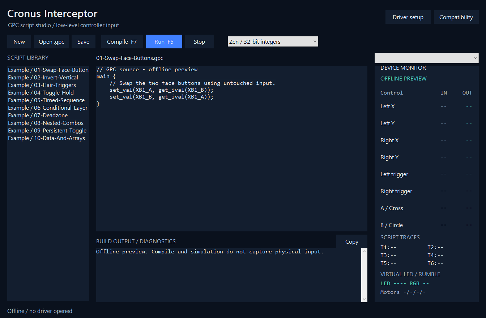

# Cronus Interceptor - GPC Controller Script Studio for Windows

Open, edit, compile and run compatible **Cronus `.gpc` source scripts** on your
connected Windows controllers using the
[Interceptor Gamepad & Controller kernel filter driver](https://github.com/TitanCSA/Interceptor-Gamepad-Controller).
Native C++17, an English editor, a script library, live IN/OUT values and precise
source diagnostics. No Cronus device is needed for the supported controller path.

**[Download](https://github.com/TitanCSA/Cronus-Interceptor/releases/latest)** |
[Driver setup](https://github.com/TitanCSA/Interceptor-Gamepad-Controller/releases/latest) |
[Compatibility](docs/COMPATIBILITY.md) | [Build and tests](docs/BUILD.md)

**Compatibility preview:** this is an independent GPC implementation, not the
official Zen compiler or firmware. It does **not** execute every GPC script or
reproduce every Cronus hardware feature. Successful compilation alone does not
prove hardware parity. Check the compatibility report and
[public-script test results](docs/VALIDATION.md) before choosing a script.

## Start

1. Install the **Gamepad & Controller edition** of Interceptor and restart Windows
   when its setup requests it. Close other controller capture/remapping apps.
2. Extract the portable ZIP and open **CronusInterceptor.exe**. Accept elevation.
3. Double-click a library script or choose **Open .gpc**. Select 32-bit Zen or
   16-bit legacy integer mode, then **Compile / F7**.
4. Choose **Run / F5**. The script runs independently for each captured controller.
   **Stop / Shift+F5** releases capture and restores physical passthrough.

Opening or editing a script does not execute it. A compilation error leaves an
already running script unchanged. A runtime fault stops capture, reports its
line/column and restores physical input. An instruction budget prevents a script
with an infinite loop from holding the input path indefinitely.

**Driver setup** opens the correct upstream release; this application never
silently installs a driver or bundles an old setup executable.

## Editor and script library

- **New / Ctrl+N**, **Open / Ctrl+O**, **Save / Ctrl+S**, undo/redo and standard
  clipboard shortcuts. The editor preserves plain UTF-8 `.gpc` source.
- Ten included, editable [examples](Scripts) cover face-button swaps, axis
  inversion, triggers, layers, timed sequences, nested combos and persistence.
- New scripts and edited examples can be saved under
  `%LOCALAPPDATA%\TitanCSA\CronusInterceptor\Scripts`; that folder appears in the
  library alongside the supplied examples. The original imported file is not
  overwritten by a library Save As.
- **Copy** copies the complete build/runtime diagnostic text.

The device menu chooses the monitor preview; the running script applies to all
compatible controllers in the active capture. IN means the received physical
control value; OUT means the encoded output accepted for forwarding. `--` means
no usable reading. This is not proof that a particular game consumed the report.

## GPC execution

The compiler builds bounded bytecode; it never converts a script to native code
or invokes an external executable. Controller values use GPC's integer
percentages: buttons and triggers `0..100`, sticks `-100..100`. Negative Y means
up; native XInput/GIP Y coordinates are converted accordingly.

`main` uses a **10 ms default virtual cycle**. `vm_tctrl(offset)` adjusts the next
cycle from that base, including `-9` for 1 ms. New physical reports do not run
`main` early. Combos continue on timer wakes when the controller is motionless;
`wait` does not block the capture worker. Actual Windows scheduling is not a
hard-real-time guarantee and can differ from a physical Cronus device.

HID axes use descriptor metadata. Standard button usages use a generic layout,
with a Sony layout for Sony-vendor controllers. Nonstandard HID layouts and
sensor/touch/paddle features need explicit verification; their semantics cannot
be deduced universally from a report descriptor.

`SPVAR` values are saved for the script file identity; `PVAR` values are shared
across scripts. Storage is under your HKCU registry. Cached atomic values are
used by the input worker; a separate worker batches registry writes. These are
software persistence namespaces, not eight physical Cronus EEPROM slots.

**Virtual LED and rumble commands** are displayed in the monitor and require
acknowledging a compatibility notice before execution. They do not drive physical
controller LEDs/motors. Touchpad synthesis, OLED drawing, adaptive-trigger
feedback, physical battery/rumble reads, console authentication, Cronus slot
programming, encrypted GamePacks and GPC2 are outside this release's support.
Unsupported calls produce diagnostics; they are not silently discarded.

## Driver, source and intended use

This project is an **example of building an application with the Interceptor
Gamepad & Controller SDK**, inspired by
[GamePad Remapper](https://github.com/TitanCSA/GamePad-Remapper).
Application and SDK sources are included; **kernel source is not published**.
The app is MIT licensed; driver binaries have [separate terms](DRIVER-BINARY-LICENSE.txt).

The installed driver's demo allowance applies to all apps of that edition. Install the current Microsoft-signed **one-hour** driver (kernel **1.0.12.0**); restart Windows after upgrading from an older demo clock. Expiry restores
passthrough. Use **Windows Restart** to renew the allowance. For an unrestricted
driver, DM **`titancsa`** on Discord.

Cronus and Zen are names of their respective owners. This is an independent
project, not affiliated with or endorsed by Cronus/Collective Minds. It does not
include their compiler, firmware, branding assets or protected scripts.

Created for legitimate customization, accessibility, development and testing.
You are responsible for your use of the app, driver and SDK and for compliance
with applicable law and service rules. The author does not authorize unlawful
use and disclaims warranties and liability to the extent permitted by applicable
law. See [LICENSE](LICENSE); mandatory legal rights remain unaffected.
